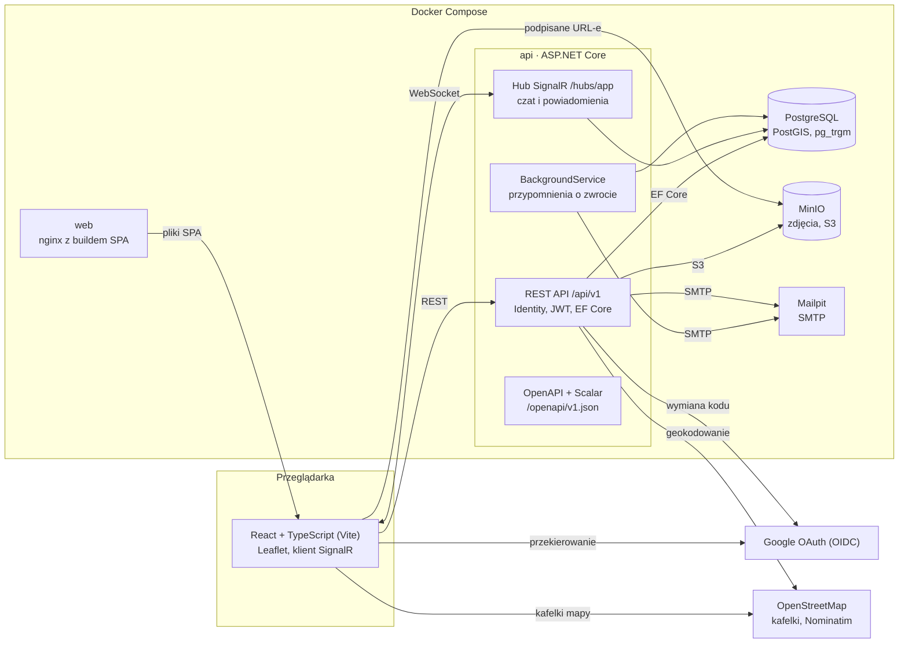
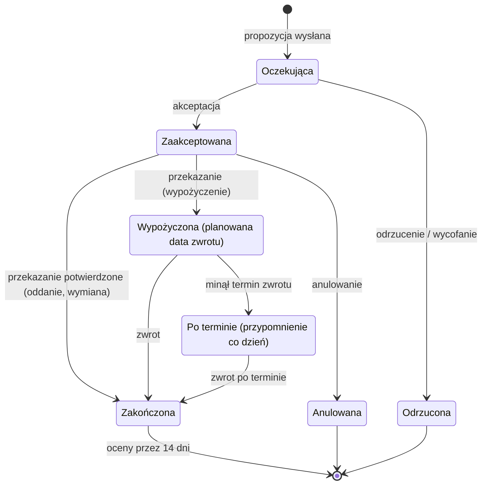

# Architektura w skrócie

SPA w przeglądarce rozmawia z jednym kontenerem API przez REST i WebSocket; API jako jedyne sięga do bazy, MinIO, poczty i geokodowania.

## Komponenty

Kafelki mapy przeglądarka pobiera bezpośrednio z OpenStreetMap, a zdjęcia przez podpisane URL-e z MinIO ([ADR-009](adr/009-zdjecia-minio.md)).

## Cykl życia propozycji i transakcji

Oddanie i wymiana kończą się po potwierdzeniu przekazania; wypożyczenie dopiero po potwierdzeniu zwrotu, a system pilnuje terminu w tle ([ADR-011](adr/011-przypomnienia-background-service.md)).
